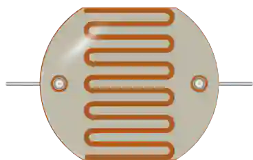
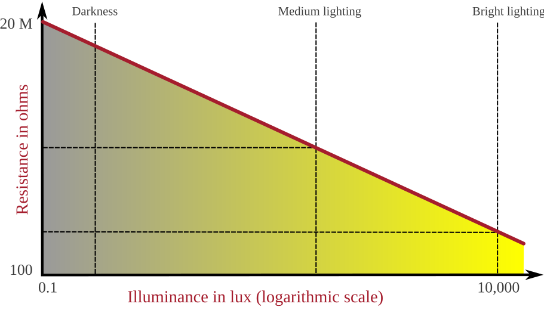

# LDR (photoresistor)

A photoresistor (LDR) is a resistive component whose value decreases as its illuminance increases. This variation is not linear and follows this law:

$$\Large R = R_{L_0} \times \left(\frac{L_0}{L}\right)^{\gamma}$$

Where:
> R: resistance of the LDR in Ω,  
> $R_{L_0}$: resistance measured at the reference illuminance, in Ω,  
> $L_0$: reference illuminance (1, 10, 100 lux…),  
> L: illuminance of the LDR in lux,  
> $\gamma$: sensitivity coefficient (positive), no unit.  

Not to be confused with the [light sensor module](photoresistor.md), which is a full board (VCC/GND, analog and digital outputs).

## Pins

| Pin | Role |
|--------|------|
| **1** | Terminal 1 |
| **2** | Terminal 2 (non-polarized) |

## Properties

| Property | Role | Default |
|-----------|------|--------|
| $L_0$ | Reference illuminance (lx) | 10 |
| $R_{L_0}$ | Resistance measured at the reference illuminance (Ω) | 100 k |
| $\gamma$ | Sensitivity coefficient | 0.8 |
| lux | Illuminance at rest (lx) | 500 |

## In simulation

An **illuminance slider** appears on the part while simulating: it sets the incoming light, from darkness to full sun. Resistance follows the real LDR characteristic:

$$\large R = R_{L_0} \times \left(\frac{L_0}{L}\right)^{\gamma}$$

With the defaults: 100 kΩ at 10 lx, 4373 Ω at 500 lx (well-lit room). Resistance is capped at 10 MΩ in the dark.

## Usage

- Wire the LDR as a **voltage divider** with a fixed resistor (10 kΩ typical), the midpoint going to an analog input.
- 🚨 **Caution**: whether the divider resistor or the LDR goes to ground reverses the direction in which the voltage varies.
- The voltage read by the ADC follows the actual divider of your circuit: no need for a ready-made module to get a credible reading.
- Non-polarized part.

---

*Kablix component - Frank SAURET*
