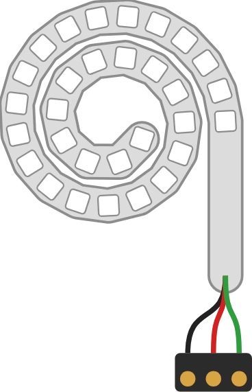

# LED strip

Strip of addressable RGB LEDs, **expandable**: the number of LEDs is a property. To fit on the sheet, the strip is drawn **coiled in a spiral**, its input on the outside, linked by three or four wires to the connector block. The **connector block is fixed**, top left: when the LED count changes, the spiral grows downwards and to the right, the connector block does not move.

## Pins

The connector block depends on the protocol.

| Pin | Role | Protocol |
|--------|------|-----------|
| **GND** | Ground | all |
| **5V** | Power (+) | all |
| **DIN** | Data in (single wire) | WS2811, WS2812(B) / SK6812 |
| **DI** | Data | APA102, WS2801 |
| **CI** | Clock | APA102, WS2801 |

## Properties

| Property | Role | Default |
|-----------|------|--------|
| `leds` | Number of LEDs (1 minimum, no maximum) | 10 |
| `protocol` | Strip protocol, see below | WS2812(B) / SK6812 |
| `colorOrder` | Colour order on the wire: RGB, BRG, GRB (WS2801 only) | RGB |

The four protocols offered:

- **One wire — WS2811**: 3 pins (GND, 5V, DIN). Colour order **RGB**, **300 µs** pause at the end of the frame.
- **One wire — WS2812(B) / SK6812 (NeoPixel)**: 3 pins (GND, 5V, DIN). Colour order **GRB**, **300 µs** pause at the end of the frame.
- **SPI — APA102 (DotStar)**: 4 pins (GND, 5V, DI, CI). SPI mode 0: start frame (32 zero bits), then 32 bits per LED (`111` + 5-bit brightness, blue, green, red), then end frame.
- **SPI — WS2801**: 4 pins (GND, 5V, DI, CI). SPI mode 0: 24 bits per LED, no start frame. A clock pause **> 500 µs** latches the colours. The colour order is adjustable (RGB by default, BRG, GRB).

Changing the protocol changes the connector block: wires already placed on a pin that disappears are lost.

## Usage

- DIN to a digital pin of the board, 5V and GND to the power supply.
- In simulation, an **unlit** LED **stays white** and a **lit** LED **has a halo** of its colour, wider the brighter it is.
- LEDs are numbered from the **input** (outside of the spiral) to the **end** (centre): LED 0 is the outermost.
- **One wire**: NeoPixel libraries (`Adafruit_NeoPixel`, `neopixel`), on any digital pin.
- **SPI**: the strip listens to the board's **hardware SPI bus** (DI on MOSI, CI on SCK), for example `machine.SPI` in MicroPython or `SPI.transfer` on Arduino. Software-emulated SPI (pins toggled by hand) is not decoded. No chaining of SPI strips.
- The strip **chains** like a ring: it consumes `leds` colours from the shared frame.
