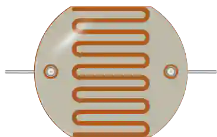
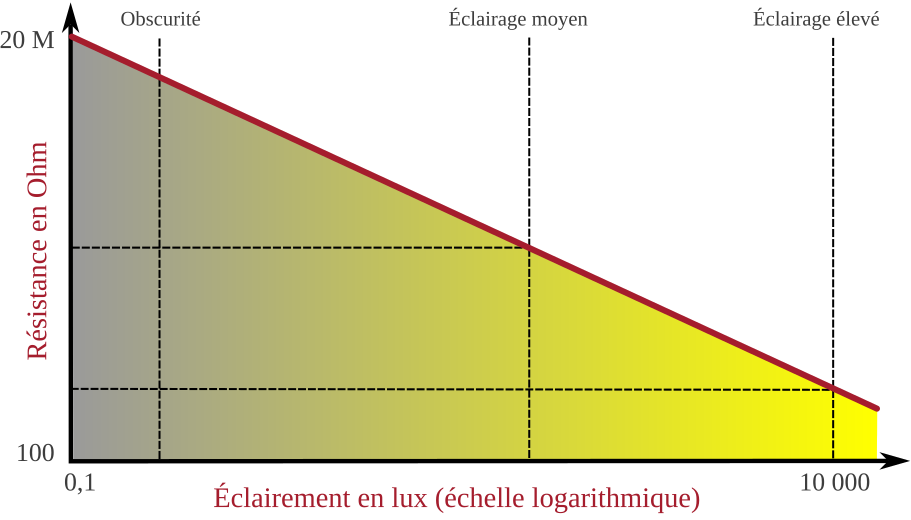

# LDR (fotorresistencia)

Una fotorresistencia (LDR) es un componente resistivo cuyo valor disminuye con la iluminancia que recibe. Esta variación no es lineal y sigue esta ley:

$$\Large R = R_{L_0} \times \left(\frac{L_0}{L}\right)^{\gamma}$$

Donde:
> R: resistencia de la LDR en Ω,  
> $R_{L_0}$: resistencia medida con la iluminancia de referencia, en Ω,  
> $L_0$: iluminancia de referencia (1, 10, 100 lux…),  
> L: iluminancia de la LDR en lux,  
> $\gamma$: coeficiente de sensibilidad (positivo), sin unidad.  

No confundir con el [módulo sensor de luz](photoresistor.md), que es una placa completa (VCC/GND, salidas analógica y digital).

## Pines

| Pin | Función |
|--------|------|
| **1** | Borne 1 |
| **2** | Borne 2 (no polarizado) |

## Propiedades

| Propiedad | Función | Por defecto |
|-----------|------|--------|
| $L_0$ | Iluminancia de referencia (lx) | 10 |
| $R_{L_0}$ | Resistencia medida con la iluminancia de referencia (Ω) | 100 k |
| $\gamma$ | Coeficiente de sensibilidad | 0,8 |
| lux | Iluminancia en reposo (lx) | 500 |

## En simulación

Durante la simulación aparece un **cursor de iluminancia** sobre el componente: ajusta la luz recibida, de la oscuridad a pleno sol. La resistencia sigue la característica real de una LDR:

$$\large R = R_{L_0} \times \left(\frac{L_0}{L}\right)^{\gamma}$$

Con los valores por defecto: 100 kΩ a 10 lx, 4373 Ω a 500 lx (habitación bien iluminada). En la oscuridad, la resistencia se limita a 10 MΩ.

## Uso

- Conecte la LDR como **divisor de tensión** con una resistencia fija (10 kΩ típica), con el punto medio a una entrada analógica.
- 🚨 **Atención**: conectar a masa la resistencia del divisor o la LDR invierte el sentido de variación de la tensión.
- La tensión que lee el ADC sigue el divisor real de su montaje: no hace falta un módulo ya hecho para obtener una lectura creíble.
- Componente no polarizado.

---

*Componente de Kablix - Frank SAURET*
