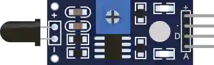

# Capteur de flamme

Détecteur de flamme (infrarouge). Sorties analogique et numérique.

## Broches

| Broche | Rôle |
|--------|------|
| **VCC** | Alimentation (+) |
| **GND** | Masse |
| **DOUT** | Sortie numérique (LOW = flamme détectée) |
| **AOUT** | Sortie analogique (tension qui baisse quand la flamme grandit) |

## Propriétés

| Propriété | Rôle | Défaut |
|-----------|------|--------|
| `sensitivity` | Seuil de détection (%) : DOUT passe à LOW quand l'intensité dépasse ce seuil | 50 |

## Utilisation

- DOUT vers une entrée numérique, AOUT vers une analogique.
- En simulation, régler l'intensité de la flamme avec le curseur du composant.

---

*Fiche adaptée et traduite de la [documentation Wokwi](https://docs.wokwi.com/parts/wokwi-flame-sensor) — © Wokwi. Composants `@wokwi/elements` (licence MIT).*
