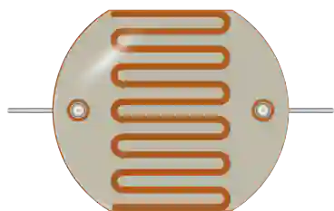
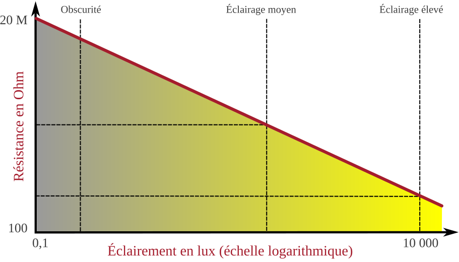

# LDR (photorésistance)

Une photorésistance (LDR) est un composant résistif dont la valeur diminue avec son éclairement. Cette variation de résistance n’est pas linéaire et répond à cette loi :

$$\Large R = R_{L_0} \times \left(\frac{L_0}{L}\right)^{\gamma}$$

Avec :
> R : Résistance de la LDR en Ω,  
> $R_{L_0}$ : résistance mesurée à l'éclairement de référence en Ω.  
> $L_0$ : éclairement de référence (1, 10, 100 lux…),  
> L : Éclairement de la LDR en lux,  
> $\gamma$ : Coefficient de sensibilité (positif) sans unité.  

À ne pas confondre avec le [module capteur de lumière](photoresistor.md), qui est une carte complète (VCC/GND, sorties analogique et numérique).

## Broches

| Broche | Rôle |
|--------|------|
| **1** | Borne 1 |
| **2** | Borne 2 (non polarisé) |

## Propriétés

| Propriété | Rôle | Défaut |
|-----------|------|--------|
| $L_0$ | Éclairement de référence (lx) | 10 |
| $R_{L_0}$ | Résistance mesurée à l'éclairement de référence (Ω) | 100 k |
| $\gamma$ | Coefficient de sensibilité | 0,8 |
| lux | Éclairement du point de repos (lx) | 500 |

## En simulation

Un **curseur d'éclairement** apparaît sur le composant pendant la simulation : il règle la lumière reçue, de l'obscurité au plein soleil. La résistance suit la caractéristique réelle d'une LDR :

$$\large R = R_{L_0} \times \left(\frac{L_0}{L}\right)^{\gamma}$$

Avec les valeurs par défaut : 100 kΩ à 10 lx, 4373 Ω à 500 lx (pièce bien éclairée). La résistance est bornée à 10 MΩ dans le noir.

## Utilisation

- Monter la LDR en **pont diviseur** avec une résistance fixe (10 kΩ typique), le point milieu vers une entrée analogique.
- 🚨 **Attention** : mettre la résistance du pont ou la LDR à la masse change le sens de variation de la tension.
- La tension lue par l'ADC suit le pont diviseur réel du montage : inutile de câbler un module tout fait pour obtenir une mesure crédible.
- Composant non polarisé.

---

*Composant Kablix - Frank SAURET*
