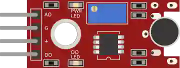

# Capteur de son

Microphone avec comparateur. Sorties analogique (niveau) et numérique (seuil).

## Broches

| Broche | Rôle |
|--------|------|
| **VCC** | Alimentation (+) |
| **GND** | Masse |
| **AOUT** | Sortie analogique (tension qui baisse quand le son monte) |
| **DOUT** | Sortie numérique (LOW = seuil dépassé) |

## Propriétés

| Propriété | Rôle | Défaut |
|-----------|------|--------|
| `sensitivity` | Seuil de détection (%) : DOUT passe à LOW quand le niveau sonore dépasse ce seuil | 50 |

## Utilisation

- DOUT vers une entrée numérique, AOUT vers une analogique.
- En simulation, régler le niveau sonore avec le curseur du composant.
- Sur le vrai module, le seuil se règle au potentiomètre.

---

*Fiche adaptée et traduite de la [documentation Wokwi](https://docs.wokwi.com/parts/wokwi-small-sound-sensor) — © Wokwi. Composants `@wokwi/elements` (licence MIT).*
