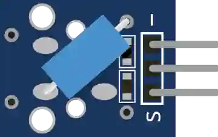

# Capteur d'inclinaison

Interrupteur à bille : se ferme/ouvre selon l'inclinaison.

## Broches

| Broche | Rôle |
|--------|------|
| **GND** | Masse |
| **VCC** | Alimentation (+) |
| **OUT** | Sortie numérique (1 = incliné) |

## Propriétés

Aucune : en simulation, l'inclinaison se commande **à la souris** (voir ci-dessous).

## Utilisation

- OUT vers une entrée numérique.

## En simulation : la souris fait basculer le capteur

- **Maintenez le clic** sur le capteur → il s'incline (le boîtier se déforme en perspective) et OUT passe à 1. **Relâchez** → il revient à plat et OUT retombe à 0.
- **Ctrl+clic** → inclinaison **verrouillée** (OUT reste à 1, clic relâché). Ctrl+clic à nouveau pour la déverrouiller.
- Une **bulle d'aide** rappelle ces gestes au survol du capteur.

---

*Fiche adaptée et traduite de la [documentation Wokwi](https://docs.wokwi.com/parts/wokwi-tilt-switch) — © Wokwi. Composants `@wokwi/elements` (licence MIT).*
