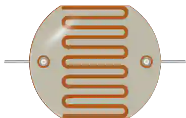
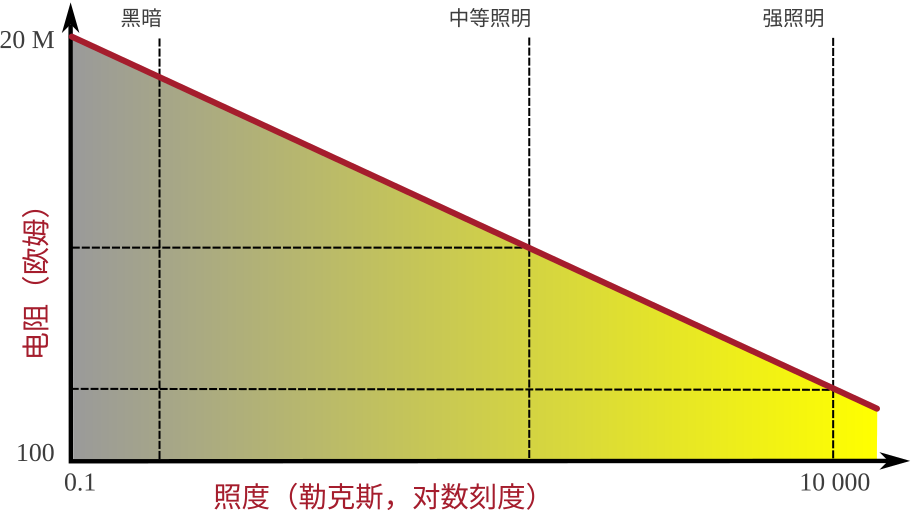

# LDR（光敏电阻）

光敏电阻（LDR）是一种电阻元件，其阻值随照度增加而减小。这种变化不是线性的，遵循以下规律：

$$\Large R = R_{L_0} \times \left(\frac{L_0}{L}\right)^{\gamma}$$

其中：
> R：LDR 的电阻，单位 Ω，  
> $R_{L_0}$：在参考照度下测得的电阻，单位 Ω，  
> $L_0$：参考照度（1、10、100 lux…），  
> L：LDR 的照度，单位 lux，  
> $\gamma$：灵敏度系数（正数），无单位。  

不要与 [光线传感器模块](photoresistor.md) 混淆，后者是一块完整的电路板（VCC/GND、模拟和数字输出）。

## 引脚

| 引脚 | 作用 |
|--------|------|
| **1** | 端子 1 |
| **2** | 端子 2（无极性） |

## 属性

| 属性 | 作用 | 默认值 |
|-----------|------|--------|
| $L_0$ | 参考照度 (lx) | 10 |
| $R_{L_0}$ | 在参考照度下测得的电阻 (Ω) | 100 k |
| $\gamma$ | 灵敏度系数 | 0.8 |
| lux | 初始照度 (lx) | 500 |

## 仿真中

仿真时元件上会出现一个 **照度滑块**：它设置入射光线，从全暗到烈日。电阻遵循真实 LDR 的特性：

$$\large R = R_{L_0} \times \left(\frac{L_0}{L}\right)^{\gamma}$$

使用默认值时：10 lx 下为 100 kΩ，500 lx（照明良好的房间）下为 4373 Ω。黑暗中电阻上限为 10 MΩ。

## 用法

- 把 LDR 与一个固定电阻（通常 10 kΩ）接成 **分压器**，中点接模拟输入。
- 🚨 **注意**：把分压电阻还是把 LDR 接地，会使电压的变化方向相反。
- ADC 读到的电压取决于你电路中实际的分压：不需要现成的模块也能得到可信的读数。
- 无极性元件。

---

*Kablix 元件 - Frank SAURET*
