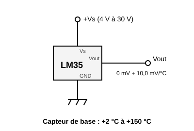
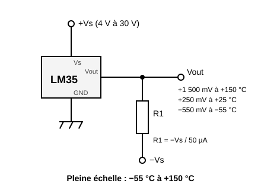
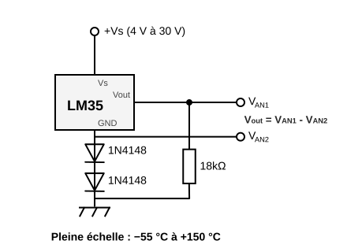

# LM35A temperature sensor


An analog thermometer that outputs a **voltage proportional to the temperature**: **10 mV per °C**, that is 250 mV at 25 °C. No calibration, no complicated maths: read the voltage and multiply by 100.

Measures from **−55 to +150 °C**, to within **±0.5 °C** at 25 °C.

Library part: it is installed through the component manager, it is not in the built-in palette.

## Pins

Seen from the front, flat side (marking) facing you (left to right):

| Pin | Role |
| --- | --- |
| **Vs** | Power, **4 V to 30 V** |
| **Vout** | Analog output, 10 mV per °C |
| **GND** | Ground |

## Power: 4 V minimum

The LM35A does not start below **4 V**. The 3.3 V of a board is therefore not enough.

- **Arduino (Uno, Mega)**: 5 V is fine.
- **Raspberry Pi Pico**: do not use **3V3**. Power Vs from **VSYS** (pin 39 — 5 V when the board is on USB). The output stays below 1.5 V up to 150 °C: it is safe on the ADC input, limited to 3.3 V.

## Wiring

The two circuits of the Texas Instruments datasheet (figures 1 and 2).

### Positive temperatures only



The usual circuit: Vs, Vout, GND, nothing else. The output does not go below 0 V, so the sensor only gives **positive temperatures**. Near 0 °C the reading lacks accuracy: the datasheet only guarantees this circuit from **+2 °C**.

### Positive and negative temperatures



It needs a **negative supply −Vs** and a **resistor R1 from Vout to −Vs**. R1 draws a constant 50 µA out of the output, which can then go below 0 V: **−550 mV at −55 °C**.

Calculation: **R1 = −Vs / 50 µA**. For −Vs = −5 V, R1 = 100 kΩ.

**Caution**: the analog input of an Arduino or Pico board **does not read negative voltages** (and can be damaged below −0.5 V). This circuit is meant for a multimeter, an oscilloscope, or the circuit below; the two analog voltages must then be measured (both are required, because the threshold voltage of the diodes varies a lot with temperature).



## Arduino example

Vs on **5V**, GND on **GND**, Vout on **A0**. ADC reference: 5 V over 1023 steps, that is about 0.5 °C per step.

```cpp
const int SENSOR = A0;

void setup() {
  Serial.begin(115200);
}

void loop() {
  float volts = analogRead(SENSOR) * 5.0 / 1023.0;
  float degrees = volts * 100.0;    // 10 mV per °C
  Serial.print("Temperature: ");
  Serial.print(degrees, 1);
  Serial.println(" C");
  delay(500);
}
```

## Raspberry Pi Pico example (MicroPython)

Vs on **VSYS**, GND on **GND**, Vout on **GP27** (ADC1). ADC reference: 3.3 V, `read_u16()` returns 0 to 65535.

```python
from machine import ADC
import time

sensor = ADC(27)                    # GP27 = ADC1

while True:
    volts = sensor.read_u16() * 3.3 / 65535
    degrees = volts * 100           # 10 mV per °C
    print("Temperature: {:.1f} C".format(degrees))
    time.sleep(0.5)
```

## In simulation

A slider on the part sets the temperature from −55 to +150 °C. Its output is `10 mV × T`.

Limits of the simulation:

- **Without a −Vs rail**, the output is **clipped at 0 V**: a negative temperature reads as 0 °C.
- **With a −Vs rail** (a supply whose + is on the board ground and whose − is tied to Vout through the resistor), the output goes below 0 V: a multimeter or the oscilloscope on Vout reads the negative voltage. The board's analog input, though, still reads 0 V: it does not measure negative voltages.
- The supply is **checked**: as long as Vs does not reach **4 V** (3V3 of a Pico, Vs not wired, a diode or resistor dropping too much), the output stays at **0 V** and the part gets a red frame with the explanation. Series diodes and resistors are taken into account; a 5 V regulator upstream is fine.

---

*Drawing and sheet: Frank Sauret. Circuits after the [Texas Instruments LM35](https://www.ti.com/product/LM35) datasheet.*
