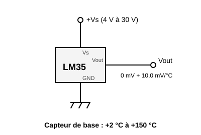
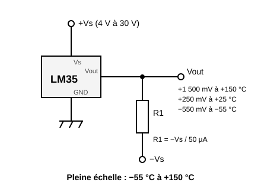
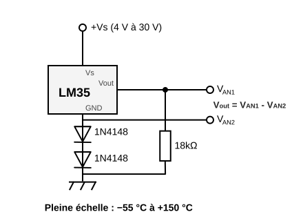

# Sensor de temperatura LM35A


Un termómetro analógico que da una **tensión proporcional a la temperatura**: **10 mV por °C**, es decir 250 mV a 25 °C. Sin calibración ni cálculos complicados: se lee la tensión y se multiplica por 100.

Mide de **−55 a +150 °C**, con una precisión de **±0,5 °C** a 25 °C.

Componente de biblioteca: se instala con el gestor de componentes, no está en la paleta de origen.

## Pines

Visto de frente, con la cara plana (inscripción) hacia uno (de izquierda a derecha):

| Pin | Función |
| --- | --- |
| **Vs** | Alimentación, **de 4 V a 30 V** |
| **Vout** | Salida analógica, 10 mV por °C |
| **GND** | Masa |

## Alimentación: 4 V como mínimo

El LM35A no arranca por debajo de **4 V**. Los 3,3 V de una placa no bastan.

- **Arduino (Uno, Mega)**: los 5 V sirven.
- **Raspberry Pi Pico**: no usar **3V3**. Alimentar Vs desde **VSYS** (pin 39: 5 V cuando la placa está conectada por USB). La salida queda por debajo de 1,5 V hasta 150 °C: no corre ningún riesgo en la entrada ADC, limitada a 3,3 V.

## Cableado

Los dos montajes de la hoja de datos de Texas Instruments (figuras 1 y 2).

### Solo temperaturas positivas



El montaje habitual: Vs, Vout, GND y nada más. La salida no baja de 0 V, así que el sensor solo da **temperaturas positivas**. Cerca de 0 °C la lectura pierde precisión: la hoja de datos solo garantiza este montaje a partir de **+2 °C**.

### Temperaturas positivas y negativas



Hace falta una **alimentación negativa −Vs** y una **resistencia R1 de Vout a −Vs**. R1 extrae una corriente constante de 50 µA de la salida, que entonces puede bajar de 0 V: **−550 mV a −55 °C**.

Cálculo: **R1 = −Vs / 50 µA**. Para −Vs = −5 V, R1 = 100 kΩ.

**Atención**: la entrada analógica de una placa Arduino o Pico **no lee tensiones negativas** (y puede dañarse por debajo de −0,5 V). Este montaje sirve con un multímetro, un osciloscopio o con el montaje siguiente; hay que medir entonces las 2 tensiones analógicas (es obligatorio medir las dos, porque la tensión umbral de los diodos varía mucho con la temperatura).



## Ejemplo Arduino

Vs en **5V**, GND en **GND**, Vout en **A0**. Referencia del ADC: 5 V en 1023 pasos, es decir unos 0,5 °C por paso.

```cpp
const int SENSOR = A0;

void setup() {
  Serial.begin(115200);
}

void loop() {
  float voltios = analogRead(SENSOR) * 5.0 / 1023.0;
  float grados = voltios * 100.0;   // 10 mV por °C
  Serial.print("Temperatura: ");
  Serial.print(grados, 1);
  Serial.println(" C");
  delay(500);
}
```

## Ejemplo Raspberry Pi Pico (MicroPython)

Vs en **VSYS**, GND en **GND**, Vout en **GP27** (ADC1). Referencia del ADC: 3,3 V, `read_u16()` devuelve de 0 a 65535.

```python
from machine import ADC
import time

sensor = ADC(27)                    # GP27 = ADC1

while True:
    voltios = sensor.read_u16() * 3.3 / 65535
    grados = voltios * 100          # 10 mV por °C
    print("Temperatura: {:.1f} C".format(grados))
    time.sleep(0.5)
```

## En simulación

Un cursor sobre el componente ajusta la temperatura de −55 a +150 °C. Su salida vale `10 mV × T`.

Límites de la simulación:

- **Sin raíl −Vs**, la salida queda **recortada a 0 V**: una temperatura negativa se lee como 0 °C.
- **Con un raíl −Vs** (una fuente cuyo + está en la masa de la placa y cuyo − va a Vout a través de la resistencia), la salida baja de 0 V: un multímetro o el osciloscopio en Vout lee la tensión negativa. La entrada analógica de la placa, en cambio, sigue leyendo 0 V: no mide tensiones negativas.
- La alimentación está **controlada**: mientras Vs no alcance **4 V** (3V3 de una Pico, Vs sin conectar, un diodo o una resistencia que hace caer demasiado la tensión), la salida se queda en **0 V** y el componente se enmarca en rojo con la explicación. Se tienen en cuenta los diodos y resistencias en serie; un regulador de 5 V antes del sensor sirve.

---

*Dibujo y ficha: Frank Sauret. Esquemas según la hoja de datos [Texas Instruments LM35](https://www.ti.com/product/LM35).*
