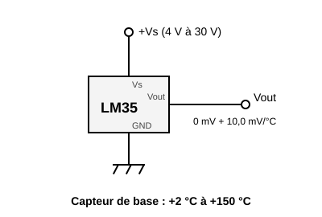
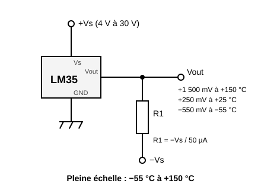
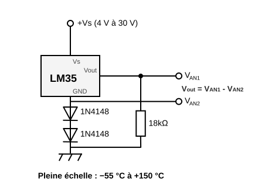

# Capteur de température LM35A


Un thermomètre analogique qui donne une **tension proportionnelle à la température** : **10 mV par °C**, soit 250 mV à 25 °C. Aucun étalonnage, aucun calcul compliqué : on lit la tension et on multiplie par 100.

Mesure de **−55 à +150 °C**, à **±0,5 °C** près à 25 °C.

Composant de bibliothèque : il s'installe par le gestionnaire de composants, il n'est pas dans la palette d'origine.

## Broches

Vu de face, côté plat (inscription) tourné vers soi (de gauche à droite) :

| Broche | Rôle |
| --- | --- |
| **Vs** | Alimentation, **4 V à 30 V** |
| **Vout** | Sortie analogique, 10 mV par °C |
| **GND** | Masse |

## Alimentation : 4 V minimum

Le LM35A ne démarre pas en dessous de **4 V**. Le 3,3 V d'une carte ne suffit donc pas.

- **Arduino (Uno, Mega)** : le 5 V convient.
- **Raspberry Pi Pico** : ne pas utiliser **3V3**. Alimenter Vs par **VSYS** (Patte 39 - 5 V quand la carte est sur l'USB). La sortie reste en dessous de 1,5 V jusqu'à 150 °C : elle ne risque rien sur l'entrée ADC, limitée à 3,3 V.

## Câblage

Les deux montages de la datasheet Texas Instruments (figures 1 et 2).

### Températures positives seulement



Le montage courant : Vs, Vout, GND, rien d'autre. La sortie ne descend pas sous 0 V, le capteur ne donne donc que les **températures positives**. Près de 0 °C la lecture manque de justesse : la datasheet ne garantit ce montage qu'à partir de **+2 °C**.

### Températures positives et négatives



Il faut une **alimentation négative −Vs** et une **résistance R1 de Vout vers −Vs**. R1 tire un courant constant de 50 µA hors de la sortie, qui peut alors passer sous 0 V : **−550 mV à −55 °C**.

Calcul : **R1 = −Vs / 50 µA**. Pour −Vs = −5 V, R1 = 100 kΩ.

**Attention** : l'entrée analogique d'une carte Arduino ou Pico **ne lit pas les tensions négatives** (et peut souffrir sous −0,5 V). Ce montage sert avec un multimètre, un oscilloscope ou en utilisant le montage ci-dessous ; il faudra alors mesurer les 2 tensions analogiques (attention il est obligatoire de mesurer les 2 tensions car les diodes ont une importante variation de leur tension de seuil en fonction de la température) .  


## Exemple Arduino

Vs sur **5V**, GND sur **GND**, Vout sur **A0**. Référence de l'ADC : 5 V sur 1023 pas, soit environ 0,5 °C par pas.

```cpp
const int CAPTEUR = A0;

void setup() {
  Serial.begin(115200);
}

void loop() {
  float volts = analogRead(CAPTEUR) * 5.0 / 1023.0;
  float degres = volts * 100.0;     // 10 mV par °C
  Serial.print("Temperature : ");
  Serial.print(degres, 1);
  Serial.println(" C");
  delay(500);
}
```

## Exemple Raspberry Pi Pico (MicroPython)

Vs sur **VSYS**, GND sur **GND**, Vout sur **GP27** (ADC1). Référence de l'ADC : 3,3 V, `read_u16()` rend 0 à 65535.

```python
from machine import ADC
import time

capteur = ADC(27)                   # GP27 = ADC1

while True:
    volts = capteur.read_u16() * 3.3 / 65535
    degres = volts * 100            # 10 mV par °C
    print("Temperature : {:.1f} C".format(degres))
    time.sleep(0.5)
```

## En simulation

Un curseur sur le composant règle la température de −55 à +150 °C. Sa sortie vaut `10 mV × T`.

Limites de la simulation :

- **Sans rail −Vs**, la sortie est **coupée à 0 V** : une température négative se lit comme 0 °C.
- **Avec un rail −Vs** (une alimentation dont le + est sur la masse de la carte, son − relié à Vout par la résistance), la sortie descend sous 0 V : un multimètre ou l'oscilloscope sur Vout lit la tension négative. L'entrée analogique de la carte, elle, lit toujours 0 V : elle ne mesure pas les tensions négatives.
- L'alimentation est **contrôlée** : tant que Vs n'atteint pas **4 V** (3V3 d'une Pico, Vs non câblé, diode ou résistance qui fait trop chuter), la sortie reste à **0 V** et le composant s'encadre en rouge avec l'explication. Les diodes et résistances en série sont prises en compte ; un régulateur 5 V en amont convient.

---

*Dessin et fiche : Frank Sauret. Schémas d'après la datasheet [Texas Instruments LM35](https://www.ti.com/product/LM35).*
