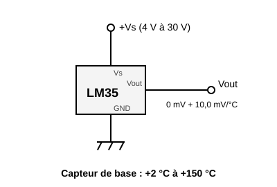
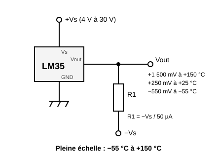
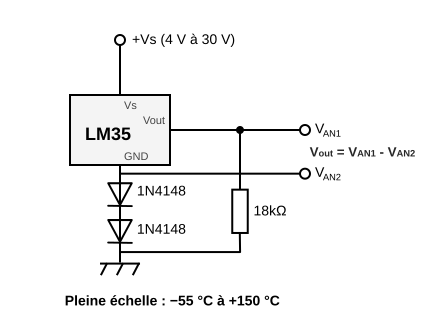

# LM35A 温度传感器


一种模拟温度计，输出**与温度成正比的电压**：**每 °C 10 mV**，即 25 °C 时为 250 mV。无需校准，也无需复杂计算：读出电压再乘以 100 即可。

测量范围 **−55 至 +150 °C**，25 °C 时精度 **±0.5 °C**。

库元件：通过元件管理器安装，不在内置元件栏中。

## 引脚

从正面看，平面（印字面）朝向自己（从左到右）：

| 引脚 | 作用 |
| --- | --- |
| **Vs** | 电源，**4 V 至 30 V** |
| **Vout** | 模拟输出，每 °C 10 mV |
| **GND** | 地 |

## 电源：至少 4 V

LM35A 低于 **4 V** 时无法工作。因此开发板的 3.3 V 不够用。

- **Arduino（Uno、Mega）**：5 V 即可。
- **Raspberry Pi Pico**：不要使用 **3V3**。用 **VSYS** 给 Vs 供电（39 号引脚，开发板接 USB 时为 5 V）。直到 150 °C 输出都低于 1.5 V：对限制在 3.3 V 的 ADC 输入没有任何风险。

## 接线

Texas Instruments 数据手册中的两种电路（图 1 和图 2）。

### 仅正温度



常用电路：Vs、Vout、GND，别无其他。输出不会低于 0 V，因此传感器只能给出**正温度**。在 0 °C 附近读数不够准确：数据手册只保证该电路从 **+2 °C** 起有效。

### 正温度和负温度



需要一个**负电源 −Vs**，以及一个**从 Vout 接到 −Vs 的电阻 R1**。R1 从输出端抽取 50 µA 的恒定电流，输出因此可以低于 0 V：**−55 °C 时为 −550 mV**。

计算：**R1 = −Vs / 50 µA**。−Vs = −5 V 时，R1 = 100 kΩ。

**注意**：Arduino 或 Pico 开发板的模拟输入**不能读取负电压**（低于 −0.5 V 时可能损坏）。该电路适用于万用表、示波器，或使用下面的电路；此时需要测量 2 个模拟电压（必须测量这两个电压，因为二极管的阈值电压随温度变化很大）。



## Arduino 示例

Vs 接 **5V**，GND 接 **GND**，Vout 接 **A0**。ADC 参考电压：5 V 分 1023 级，即每级约 0.5 °C。

```cpp
const int SENSOR = A0;

void setup() {
  Serial.begin(115200);
}

void loop() {
  float volts = analogRead(SENSOR) * 5.0 / 1023.0;
  float degrees = volts * 100.0;    // 每 °C 10 mV
  Serial.print("Temperature: ");
  Serial.print(degrees, 1);
  Serial.println(" C");
  delay(500);
}
```

## Raspberry Pi Pico 示例（MicroPython）

Vs 接 **VSYS**，GND 接 **GND**，Vout 接 **GP27**（ADC1）。ADC 参考电压：3.3 V，`read_u16()` 返回 0 至 65535。

```python
from machine import ADC
import time

sensor = ADC(27)                    # GP27 = ADC1

while True:
    volts = sensor.read_u16() * 3.3 / 65535
    degrees = volts * 100           # 每 °C 10 mV
    print("Temperature: {:.1f} C".format(degrees))
    time.sleep(0.5)
```

## 仿真

元件上的滑块可在 −55 至 +150 °C 之间设置温度。其输出为 `10 mV × T`。

仿真的局限：

- **没有 −Vs 电源轨时**，输出**限制在 0 V**：负温度读作 0 °C。
- **有 −Vs 电源轨时**（一个电源，+ 接开发板的地，− 通过电阻接 Vout），输出会低于 0 V：接在 Vout 上的万用表或示波器能读到负电压。而开发板的模拟输入仍然读到 0 V：它不能测量负电压。
- 电源**受到检查**：只要 Vs 未达到 **4 V**（Pico 的 3V3、Vs 未接线、二极管或电阻压降过大），输出就保持 **0 V**，元件会显示红框和说明。串联的二极管和电阻会被计算在内；在前面加一个 5 V 稳压器即可。

---

*绘图与说明：Frank Sauret。电路图参考 [Texas Instruments LM35](https://www.ti.com/product/LM35) 数据手册。*
